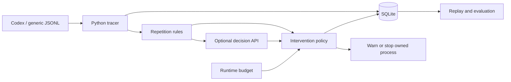

# LoopGuard: Detecting Unproductive Agent Execution

*Course project proposal*

## Research question

Can a lightweight monitor reduce wasted agent execution without harming task success? Coding agents can repeat failed actions or revisit unchanged results. Fixed budgets limit cost; selective interruption may stop waste earlier, but can also disrupt productive retries.

## Scope and design

Build a Python CLI managed with uv with SQLite storage, targeting single-agent Codex tasks. A common JSONL schema allows future harness adapters. The contribution is a comparison of interruption policies under partial observability. Dashboards, fine-tuning, multi-agent coordination, and a second full harness integration are outside the core scope.

The tracer records tool calls, outcomes, reported token usage, and decisions. Rules flag repeated unchanged outcomes; an optional typed model evaluates a bounded, deterministic evidence summary and returns a stop probability. Observation is the default; enforcement requires explicit configuration. API failures continue observation, while the runtime limit remains active.

Context length and generation TPS are recorded only when supported by source measurements. Silence alone is not evidence of wasted effort. External calls send grouped counts, evidence IDs, and short unredacted excerpts within a 6 KB budget. Raw traces remain local; summaries can omit relevant details and do not infer progress from silence. A skill or MCP interface may later expose summaries, but cannot be assumed to control the host.

| Decision model | Role | Verification |
| --- | --- | --- |
| TypeSafe Jev | Typed decision baseline | Mock-tested adapter |
| Cloudflare Clef-Flash | Alternative decision model | Mock-tested adapter |
| Qwen decision-model-preview | Additional comparison | Request adapted; response schema needs live validation |

All three use the same question and trace window. API configuration is documented in the [README](README.md). No authenticated model evaluation has been run.

## Experiments

| Condition | Policy |
| --- | --- |
| A: Budget | Stop only at the runtime limit |
| B: Rules | Budget plus repetition-based interruption |
| C: Decision model | Budget plus model-confirmed repetition interruption |

**Dataset.** Calibrate on six development tasks, then freeze settings and evaluate twelve held-out tasks from different families. Include ordinary coding, unproductive loops, legitimate retries, and slow successful operations. Three runs per condition give 108 runs for one judge model, or 72 for an A/B pilot. Additional judge models add 36 runs each.

**Controls.** Keep the agent, prompts, permissions, and budgets fixed. Reset repository snapshots, use executable success checks, and randomize condition order. Two annotators label baseline segments and the earliest defensible intervention; report agreement and uncertain labels. The judge's predictions are not ground truth.

| Metric | What it tests |
| --- | --- |
| Task success, false stops | Harm to productive work |
| Tokens, time, tool calls | Savings including judge overhead |
| Precision, recall, detection delay | Agreement with annotated segments |
| Cancellation failures | Whether live interruptions take effect |

Use replay for detector analysis and fresh live runs for realized savings. Report per-task results and task-level bootstrap intervals; stochastic runs are imperfect counterfactuals. Optional ablations compare repetition thresholds, summary budgets, and judge models. Current limits are eight judge calls per run, spaced by four tool events; a separate token budget is future work.

**Exploratory target:** 20% fewer median tokens on unproductive runs, with at most a five-percentage-point drop in overall success. The small sample cannot establish statistical non-inferiority. No experiments have been run yet.

## Deliverables and schedule

| Stage | Deliverable |
| --- | --- |
| Weeks 1–2 | Tracer, SQLite records, rules, supervised interruption, tests |
| Week 3 | Live API validation and development-set calibration |
| Week 4 | Held-out experiments, ablations, failure analysis |

The prototype and cross-platform CI/release workflows are implemented. Live provider validation, evaluation tasks, and results remain outstanding. Main risks are false interruptions, hidden progress, and incomplete telemetry; conclusions will be limited to the evaluated tasks and harness.

## Reference

[Codex non-interactive mode](https://learn.chatgpt.com/docs/non-interactive-mode) documents the primary JSONL interface. Provider references and commands are in the [README](README.md#typed-decision-api).

## Presentation template

`presentation/` is an independent HTML-first Slidev/Markdown subproject with React + TypeScript widgets and global Paul Tol Muted CSS tokens. It uses npm for frontend dependencies; Python remains managed by uv. Its synthetic examples do not add experiments or measured results. See [presentation instructions](presentation/README.md).

The proposal demo deck follows the research question, design, experiments, schedule and references above. `.github/workflows/presentation.yml` validates pull requests and deploys the HTML build to GitHub Pages on `main` after Pages is configured to use GitHub Actions. No measured experiment results are included.

The presentation includes three visx charts (policy token use, success/false-stop rates, and cumulative tool calls) with explicitly fabricated data for layout demonstration. They are not experimental results, predictions, or evidence for the exploratory target.
