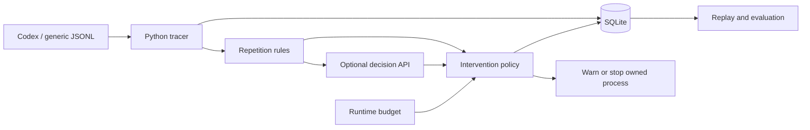
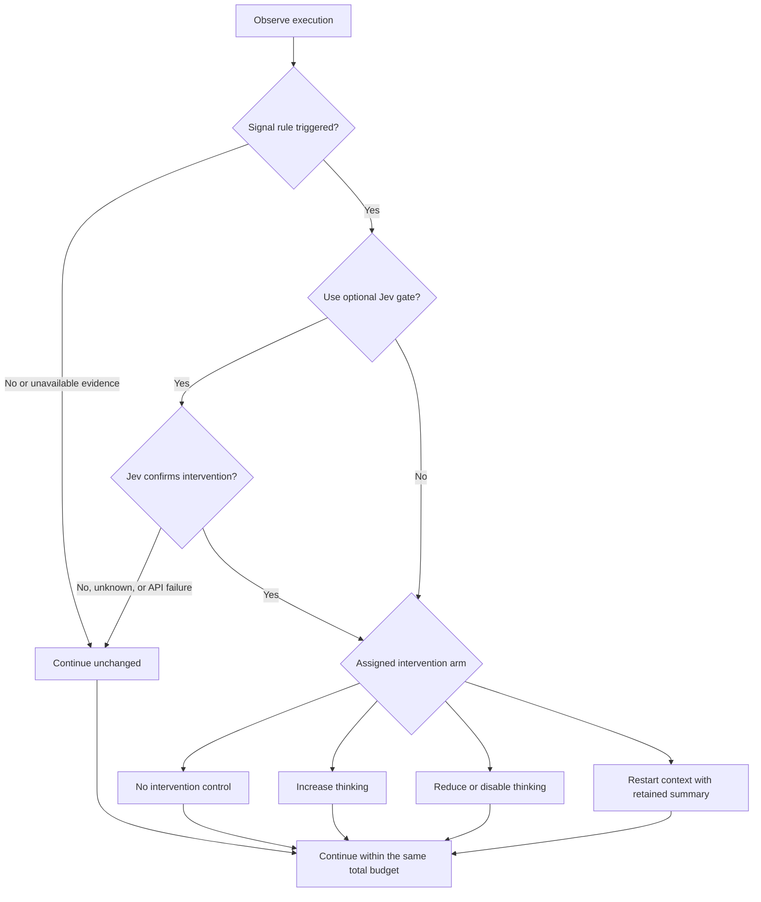

# LoopGuard: When and How to Intervene in Stalled Agent Execution

*Course project proposal*

## Research question

Can a lightweight monitor identify stalled execution and redirect the remaining budget toward useful progress? We separate **when to intervene** from **how to intervene**: adjusting reasoning effort or restarting context. The objective is higher task success under the same budget, or lower total cost at comparable success. Excessive thinking causing stalls is a hypothesis to test, not an assumed fact.

## Scope and design

Build a Python CLI managed with uv with SQLite storage, targeting single-agent Codex tasks. A common JSONL schema allows future harness adapters. The intended empirical contribution is a controlled comparison of intervention timing and intervention actions under partial observability. Dashboards, fine-tuning, multi-agent coordination, and a second full harness integration are outside the core scope.

The current monitoring implementation:

The tracer records tool calls, outcomes, reported token usage, and decisions. Rules flag repeated unchanged outcomes; an optional typed model evaluates a bounded, deterministic evidence summary and returns a stop probability. Observation is the default; enforcement requires explicit configuration. API failures continue observation, while the runtime limit remains active.

Context length and generation TPS are recorded only when supported by source measurements. Silence alone is not evidence of wasted effort. External calls send grouped counts, evidence IDs, and short unredacted excerpts within a 6 KB budget. Raw traces remain local; summaries can omit relevant details and do not infer progress from silence.

| Decision model | Role | Verification |
| --- | --- | --- |
| TypeSafe Jev | Typed decision baseline | Mock-tested adapter |
| Cloudflare Clef-Flash | Alternative decision model | Mock-tested adapter |
| Qwen decision-model-preview | Additional comparison | Request adapted; response schema needs live validation |

All three use the same question and trace window. API configuration is documented in the [README](README.md). No authenticated model evaluation has been run.

## Experiments

**Tasks.** Use the six [sandbox fixtures](experiments/README.md): recoverable/persistent service failure, consistent/conflicting requirements, and broken/already-correct code. The local service is inspectable and recovers by call count. Review valid blocker/clarification reports separately from executable success. This section supersedes the earlier stopping-policy pilot; [related work](RELATED_WORK.md) motivates the cost-control question.

**Planned task extensions.** Add two candidate families beyond the sandbox pilot; environments, instance selection, budgets, and detailed protocols remain to be designed.

| Family | Candidate sources | Task and progress evidence |
| --- | --- | --- |
| SQL performance optimization | [Join Order Benchmark](https://github.com/gregrahn/join-order-benchmark), [Effi-SQL](https://bird-critic.github.io/) | Improve query runtime while preserving correctness; track the best validated runtime under fixed execution conditions. |
| MaxSAT optimization | [MaxSAT Evaluation instances](https://www.cs.toronto.edu/maxsat-lib/maxsat-instances/ms-evals/) | Improve a feasible assignment within a fixed budget; track objective value and gap to a certified optimum or bound, distinguishing these from best-known values. |

Include both improvable and near-reference starting points. Task difficulty, NP-hardness, long context, or a temporary plateau alone does not establish wasted effort; separate agent activity from solver/database compute time. Compare continuation and context restart under the same total budget to investigate whether accumulated history affects recovery.

**Training-data contamination.** Public benchmark exposure is unknown. Use public instances as reference baselines and separately evaluate newly generated local instances: vary SQL data distributions and query structure, and generate fresh MaxSAT structures and weights. Validate correctness, feasibility, and reference performance or bounds before evaluation. Split by source/template or generator family, not merely random seed, and keep evaluation instances and reference solutions out of agent-visible development material. Renaming identifiers or permuting variables alone does not remove structural overlap. Record provenance, generator versions, and seeds locally for reproducibility; these controls reduce risk but do not prove absence of contamination. Report public and fresh-instance results separately.

**Lightweight environment requirement.** Prefer small, local, offline-capable task environments with minimal dependencies, bounded CPU/memory/disk use, and fast setup and reset. For SQL, start with Python's embedded SQLite where its semantics and query plans support the intended task; consider DuckDB only for a demonstrated analytical-query need. PostgreSQL is optional, used only when required by a selected benchmark or database-specific behavior, rather than a default service dependency. Ported or scaled-down workloads must be labeled as adaptations, with correctness and optimization opportunities revalidated; do not claim comparability with original-engine benchmark scores. For MaxSAT, prefer small local instances and a lightweight checker; add an external solver only when needed for reference solutions or bounds. Record environment size, setup time, and resource limits during pilot calibration, then freeze limits before evaluation. No hosted database or GPU should be required for the task environment; model inference is accounted for separately.

**Two stages.** Calibrate on separate development variants and freeze settings before evaluation. For the sandbox pilot, run each condition on six configurations with three repetitions. Fix the base model, initial reasoning effort, image, prompt, permissions, and total budget; randomize condition order and reset the sandbox between runs.

| Stage | Hold fixed | Experimental conditions |
| --- | --- | --- |
| How to intervene | One trigger; no judge; identical setup before triggering | Continue unchanged; increase thinking; reduce/disable thinking; restart context at unchanged effort |
| When to intervene | One action selected on development variants | No intervention; signal rules; identical signal rules plus Jev confirmation |

Change reasoning effort only at a supported model-call boundary. Use an initial setting that permits both increases and decreases; call the low arm non-thinking only if genuinely supported. Context restart retains the task goal, code state, failed attempts, and next hypothesis. It does not reset the environment or grant a new budget. Freeze a shared intervention cap and cooldown; do not initially combine effort changes with restarts. Other base models and judges are follow-up comparisons, not a full factorial pilot.

The planned decision tree below shows alternative experimental arms, not a learned action selector:

**Signals and evidence.** Candidate rules use repeated unchanged outcomes, sustained generation-TPS decline relative to a prior measured window, or abrupt context growth. Freeze thresholds, windows, and persistence requirements on development variants. These are suspected-degradation signals: a large tool result or lower TPS alone does not establish failure. Measure generation time separately from tool waits; never infer context from cumulative input tokens. Current Codex telemetry lacks reliable TPS/context snapshots, so validate an instrumented source first or explicitly limit the pilot to repetition. Missing metrics and judge failures never constitute evidence to intervene. All judge conditions use the same bounded evidence and call limits; the proposed intervention judgment requires updating the current stop-only question.

**Outcomes.** Report task success and total resource cost by family, including all attempts, judge calls, summaries, and restart overhead. Separately report wall time, tool calls, recovery rate after triggering, and cost to the next task-defined progress milestone. Judge scores and TPS recovery are not ground truth for task progress. Report harmful interventions and reviewed blocker outcomes alongside savings. Missing usage remains unknown; monetary savings require complete billing data. Every condition shares the same task-wide budget, including restarts. Use complete-run outcomes, not only successful runs or post-trigger costs.

Replay can compare trigger decisions on fixed prefixes; it cannot establish outcomes after a different reasoning mode or context restart. Use fresh live trials for realized savings, report per-task counts and variation, and avoid broad claims from six fixtures. No live agent or authenticated judge experiments have been run.

## Deliverables and schedule

| Stage | Deliverable |
| --- | --- |
| Weeks 1–2 | Tracer, SQLite records, rules, supervised interruption, tests |
| Week 3 | Telemetry and judge validation; effort/restart controls; development calibration |
| Week 4 | Two-stage live comparisons, cost accounting, failure analysis |

The prototype and cross-platform CI/release workflows are implemented. Six sandbox task fixtures are implemented. Metric triggers, reasoning-effort controls, context restarts, live provider validation, and experimental results remain outstanding. Observation-only defaults remain unchanged. Main risks are false interruptions, hidden progress, and incomplete telemetry; conclusions will be limited to the evaluated tasks and harness.

## Reference

[Codex non-interactive mode](https://learn.chatgpt.com/docs/non-interactive-mode) documents the primary JSONL interface. Provider references and commands are in the [README](README.md#typed-decision-api).

## Presentation

The [presentation](presentation/README.md) communicates the method and evaluation framework independently of this proposal's schedule. Its synthetic charts illustrate the intended analyses and provide no empirical evidence.

Candidate extension environments are DeepSeek Harness, Grok Build, and Cursor Agent CLI. Codex remains the implemented adapter and primary evaluation scope; candidate integrations and cross-harness experiments are not yet implemented.

The presentation uses Pele to render Mermaid architecture, decision-flow, evidence-pipeline, sequence, and evaluation diagrams with the same Georgia and Paul Tol Muted styling. These diagrams describe implemented monitoring semantics or explicitly planned evaluation.
