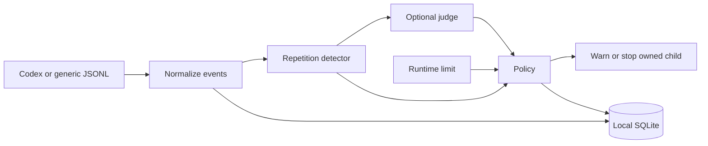
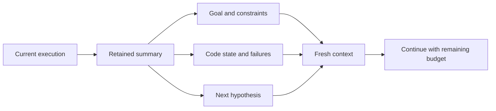

COMP7607A · RESEARCH DESIGN

# LoopGuard

## When and how to intervene in stalled agent execution

A lightweight monitor for useful progress under a shared execution budget.

Implemented prototype · Planned evaluation · November 2026

Notes:
Source: PROPOSAL.md, README.md, experiments/README.md. This deck follows the current proposal, which supersedes the earlier stopping-policy pilot. No live agent or authenticated judge experiments have been run. There are no measured performance results in this presentation.

---

01 / RESEARCH QUESTION

# Repetition is evidence, not a verdict

<h2>A useful retry</h2>

A temporary service failure resolves on a later request. Stopping too early prevents success.

<h2>A stalled attempt</h2>

The service stays unavailable. More identical calls may consume the budget without changing the outcome.

Can external monitoring distinguish these cases well enough to improve the cost–success tradeoff?

Notes:
The sandbox service is inspectable and call-count driven. These are motivating cases, not claims that the observations are indistinguishable. Reading the service may reveal the blocker. Excessive thinking causing stalls is a hypothesis, not an established mechanism.

---

01 / OBJECTIVE

# Success under a shared budget

maximizeπ E[S(π)] &nbsp; subject to &nbsp; Ctotal(π) ≤ B

| Symbol | Operational meaning |
| --- | --- |
| S | Independently evaluated task success; blocker outcomes reviewed separately |
| π | Trigger, optional confirmation gate, and assigned intervention action |
| B | One task-wide resource budget across all attempts |

Also compare total cost at comparable success. A lower cost alone is insufficient.

Notes:
This is a compact formalization of the proposal's objective, not an implemented optimizer. Budgets must specify resource units; tokens, money, wall time and tool calls cannot be added without conversion. Only complete billing data permits monetary claims. Task-level counts and variation are needed for a small pilot.

---

01 / RESEARCH LOGIC

# Separate action from timing

| Question | Controlled comparison | What it isolates |
| --- | --- | --- |
| How to intervene? | Continue / more effort / less effort / restart | Effect of the assigned action at one fixed trigger |
| When to intervene? | No intervention / rules / rules + Jev | Effect of triggering and confirmation for one frozen action |

Choose the action on development variants. Freeze it before the timing evaluation.

Notes:
This is a two-stage experimental design, not an adaptive action selector. Do not choose the best action on evaluation tasks. Other base models, judges and harnesses are follow-up comparisons, not a full factorial pilot.

---

02 / IMPLEMENTED SYSTEM

# Local monitoring architecture

Implemented · Observation is the default; stopping requires explicit configuration.

Notes:
Sources: README.md and loopguard/core.py, loopguard/cli.py. The Python CLI owns process control separately from event decoding. Codex and generic JSONL are implemented; Cursor, DeepSeek and Grok are candidate extensions. No second full harness is in the core evaluation scope. Stopping does not roll back file edits.

---

02 / DETECTION RULE

# A precise, deliberately limited signal

xt = (tool, arguments, result, failed) rt = Σi ∈ Wₜ 𝟙[xi = xt] &nbsp; ; &nbsp; trigger if rt ≥ 3

- Wt: latest **16 completed tool events** since explicit progress.
- Match full normalized outcomes; shortened excerpts do not define identity.
- Explicit progress clears the window; the repeat threshold is configurable.

A repeated outcome can justify a check. It does not establish that progress is impossible.

Notes:
Sources: README.md, loopguard/core.py, loopguard/summary.py. The default threshold is three and accepts values 2–16. The notation summarizes the detector's observable repetition criterion, not a proof of a semantic loop. Codex does not currently supply explicit progress signals.

---

02 / EVIDENCE AVAILABILITY

# Unknown telemetry stays unknown

| Evidence | Codex adapter | Generic event schema |
| --- | --- | --- |
| Completed tool outcomes | Command / MCP items | tool_end events |
| Token usage | At turn completion | Supplied interval deltas |
| Explicit progress | Unknown | Optional explicit signal |
| Generation TPS / context | No reliable snapshots | Optional measured fields |

Start with repetition unless an instrumented source validates the additional signals.

Notes:
Source: README.md and PROPOSAL.md, Signals and evidence. Generation TPS requires paired output tokens and generation time. Tool waits are not generation time. Context cannot be inferred from cumulative input tokens. Silence alone never triggers stopping. A large result, long context or low TPS does not prove failure.

---

02 / OPTIONAL CONFIRMATION

# Bounded evidence, conservative fallback

repetition → evidence summary → p(stop) ≥ 0.9 → configured policy

| Current guardrail | Implemented behavior |
| --- | --- |
| Evidence | Latest 16 tool events; grouped counts, IDs and excerpts; ≤ 6 KB |
| Calls | Up to 8 per run; spaced by 4 tool events |
| Timeout | 3 seconds, capped by remaining runtime |
| Failure / unknown | Continue observation; independent runtime limit still applies |

Excerpts are lossy and unredacted. External inference is opt-in.

Notes:
Source: README.md. The threshold is provisional. Summaries omit the task prompt. Raw traces remain local, but external calls disclose summary contents, possibly source code or secrets. The current stop-only question must be changed and validated for the proposed intervention judgment. During a judge call the owned child continues running.

---

02 / ADAPTER VERIFICATION

# Decision models: readiness before ranking

| Candidate | Role | Current verification |
| --- | --- | --- |
| TypeSafe Jev | Confirmation gate in stage 2 | Mock-tested adapter |
| Cloudflare Clef-Flash | Follow-up judge comparison | Mock-tested adapter |
| Qwen decision-model-preview | Follow-up judge comparison | Request adapted; live response validation pending |

No authenticated evaluation yet. Compare judges using the same question, evidence window and call limits.

Notes:
Sources: PROPOSAL.md and README.md. Provider cost/context specifications are intentionally not used as evidence of decision quality. The core timing experiment names Jev; other judges are follow-up comparisons. Missing or invalid responses must remain unknown.

---

03 / PILOT TASKS

# Three pairs with different success criteria

| Pair | Control | Trap / boundary case |
| --- | --- | --- |
| Service retry | Service ready on request 5 | Persistent failure; review blocker report |
| Requirements | Two consistent fee examples | Input 1 requires both 5 and 8; request clarification |
| Completion | Fix an incorrect sum | Sum already correct; verify and finish |

Independent acceptance separates executable success, valid clarification, and unresolved failure.

Notes:
Source: experiments/README.md. Fixture names are retry-control/trap, conflict-control/trap, finish-control/trap. Conflict-trap always needs human review: identify input 1, incompatible values 5 and 8, and ask for clarification. Report creation alone is not success. For retry-trap, blocker reports are reviewed separately from executable success. Extra verification is not automatically waste.

---

03 / EXPERIMENTAL CONTROL

# A reproducible, inspectable sandbox

<h2>Freeze per condition</h2>

Base model, initial effort, prompt, image ID, permissions and task-wide budget.

Randomize condition order; reset the workspace and service counter each run.

<h2>Record per run</h2>

Local trace, final workspace, evaluator output, image ID and resource usage.

Review service, counter and checks for modification before acceptance.

Pilot protocol: 60 tool calls / 300 seconds. The harness must enforce the tool-call cap.

Notes:
Source: experiments/README.md. Docker example limits CPU to 1, memory to 512 MB, pids to 128 and disables networking. The image contains tasks and local tools, not an installed agent runner. Host credentials remain outside the container; a host harness can use docker exec. LoopGuard can enforce time on an owned process. The fixture is cooperative, not a tamper-resistant grader. A check can increment the service counter. Record the built image ID, because base tags are not digest-pinned.

---

03 / STAGE 1 · PLANNED

# How to intervene

| Arm | Change at the fixed trigger | Keep unchanged |
| --- | --- | --- |
| Continue | No change | Current effort and context |
| Increase effort | Higher supported reasoning setting | Context and environment |
| Reduce effort | Lower supported reasoning setting | Context and environment |
| Restart context | Retained summary replaces history | Reasoning effort and environment |

One trigger, no judge, identical setup before triggering. Do not combine effort changes with restart.

Notes:
Source: PROPOSAL.md. Change effort only at a supported model-call boundary. Start at an effort level permitting both increases and decreases. Call the low arm non-thinking only if actually supported. Freeze a shared intervention cap and cooldown on development variants. Effort controls and context restart are not implemented yet.

---

03 / STAGE 2 · PLANNED

# When to intervene

| Condition | Trigger / confirmation | Assigned action |
| --- | --- | --- |
| No intervention | Native continuation; common hard budget | None |
| Signal rules | Frozen signal rule | Development-selected action |
| Rules + Jev | Same rule; Jev confirms | Same selected action |

6 tasks × 3 repetitions × (4 + 3 conditions) = 126 planned runs

Nominal evaluation count excludes development, calibration and follow-up model comparisons.

Notes:
Source: PROPOSAL.md. The count is derived from six configurations, three repetitions per condition, four stage-1 arms and three stage-2 conditions, with both stages run separately. It is a planning count, not completed trials or a power analysis. Stage-2 selection uses separate development variants, not evaluation outcomes. Missing metrics and judge failures do not authorize intervention. The three repetitions are a small pilot and cannot support broad claims.

---

03 / RESTART CONTRACT · PLANNED

# Restart context, retain the task

Same environment · Same effort · No fresh budget · Summary overhead included

Notes:
Source: PROPOSAL.md. This describes a planned experimental arm. Restart preserves task goal, code state, failed attempts and next hypothesis. It does not reset the sandbox. Summary compression can remove useful context; that is a threat to validity to inspect, not a guaranteed benefit.

---

03 / OUTCOME ACCOUNTING

# Measure the complete run

Ctotal = Σ Cagent attempts + Cjudge + Csummary / restart overhead

| Outcome | Reporting rule |
| --- | --- |
| Success and resource cost | By task family; include unsuccessful runs |
| Recovery after trigger | Task-defined progress / success, not judge confidence |
| Cost to next milestone | Use a validated task-specific progress event |
| Harm and blocker outcomes | Report alongside savings; manual review where required |

Account in consistent units without double-counting. Wall time and tool calls are separate measures.

Notes:
Source: PROPOSAL.md. This equation is proposed accounting notation. Summary/restart terms represent overhead not already included in the attempt totals. Missing usage stays unknown; monetary savings require complete billing data. Report per-task counts, denominators and variation. Do not condition the primary result on successful runs only. TPS recovery is not task progress.

---

03 / EVIDENCE BOUNDARY

# Replay diagnoses; live trials test outcomes

| | Fixed-prefix replay | Fresh live trials |
| --- | --- | --- |
| Can evaluate | Trigger decisions and stop timing | Success after the assigned action |
| Cost interpretation | Potential calls cut from an observed trace | Realized total cost including overhead |
| Main limitation | Cannot generate a changed trajectory | Requires reset, randomization and complete accounting |

A replayed restart cannot establish recovery. Changed reasoning or context requires a new live run.

Notes:
PROPOSAL.md explicitly supersedes the earlier stopping-policy pilot. experiments/README.md retains an observation/replay protocol with budget, repetition-stop, two-extra-event patience and rule-gated judge comparisons. Treat that protocol as diagnostic preparation, not the current primary experiment. Patience and replay scoring are planned, not implemented. RELATED_WORK.md lists additional self-assessment and stopping-policy comparisons as context, not extra arms in the two-stage pilot.

---

04 / TASK EXTENSIONS · PLANNED

# Progress beyond binary completion

| Family | Task-defined evidence | Reference and constraint |
| --- | --- | --- |
| SQL optimization | Best validated query runtime so far | Preserve correctness; fixed execution conditions |
| MaxSAT optimization | Best feasible objective so far | Certified optimum or bound; label best-known separately |

SQL: T*t = mini ≤ t, valid Ti &nbsp;&nbsp; MaxSAT: F*t = maxi ≤ t, feasible Fi

Notation uses satisfied-clause weight for MaxSAT. A plateau alone is not evidence of wasted effort.

Notes:
Source: PROPOSAL.md, Planned task extensions. These running-best expressions illustrate proposed progress tracking; no environments or measurements exist yet. For MaxSAT formulations minimizing unsatisfied weight, use the corresponding minimization objective consistently. Include improvable and near-reference starting points. Separate agent activity from solver/database compute time. Candidate sources: Join Order Benchmark, Effi-SQL and MaxSAT Evaluation instances; selection and detailed protocols remain open.

---

04 / VALIDITY CONTROLS · PLANNED

# Public and fresh instances stay separate

| Control | Design requirement |
| --- | --- |
| Provenance | Record source, generator version and seed |
| Holdout split | Split by source/template or generator family, not seed alone |
| Validation | Check correctness, feasibility and reference performance / bounds |
| Agent visibility | Keep evaluation instances and references out of development material |

Report public benchmarks and fresh local instances separately. These controls reduce contamination risk; they do not prove its absence.

Notes:
Source: PROPOSAL.md, Training-data contamination. Public benchmark exposure is unknown. Vary SQL query structure and data distribution; generate fresh MaxSAT structures and weights. Identifier renaming and variable permutation alone do not remove structural overlap.

---

04 / ENVIRONMENT DESIGN · PLANNED

# Small local environments first

<h2>SQL</h2>

Start with embedded SQLite when semantics and query plans fit the task.

Add DuckDB or PostgreSQL only for a demonstrated workload requirement.

<h2>MaxSAT</h2>

Start with small instances and a lightweight feasibility checker.

Add an external solver when reference solutions or bounds require it.

Freeze CPU, memory, disk and setup limits after calibration. Revalidate adapted workloads; do not equate them with original benchmark scores.

Notes:
Source: PROPOSAL.md, Lightweight environment requirement. Task environments should be offline-capable with fast setup and reset. No hosted database or GPU should be required for the task environment; model inference is accounted for separately. Record environment size, setup time and resource limits. SQL/MaxSAT extensions are not included in the current six-task sandbox image.

---

05 / DELIVERY STATUS

# What exists, what remains

| Status | Capability |
| --- | --- |
| Implemented | Codex / generic adapters, SQLite traces, repetition detection, explicit interruption |
| Implemented | Six sandbox fixtures; Python and presentation CI / release workflows |
| Mock-tested / partial | Decision adapters; live provider verification outstanding |
| Planned | Metric triggers, effort controls, context restart, experiment orchestration |
| Not measured | Live task success, realized savings, recovery and harmful interventions |

Observation-only defaults remain unchanged. Results are unknown until evaluated.

Notes:
Sources: PROPOSAL.md, README.md, experiments/README.md. Authored workflows and implemented fixtures do not imply that a remote deployment or experiment has run. This slide reports repository capability, not a new workflow run. No authenticated model evaluation has been conducted.

---

05 / INTERPRETATION

# The experiment must expose failure cases

| Threat | What to inspect |
| --- | --- |
| Productive repetition mistaken for a stall | Recoverable retries and harmful interventions |
| Hidden progress or missing telemetry | Unknown fields and task-defined acceptance |
| Lossy summaries or restart damage | Retained evidence and post-trigger recovery |
| Small / inspectable fixtures | Per-task counts; no universal stopping claims |

The contribution is a controlled cost–success comparison under partial observability.

Notes:
Sources: PROPOSAL.md and experiments/README.md. Task difficulty, NP-hardness, long context and a temporary plateau do not independently establish waste. The local mock service source is visible and call-count driven; do not describe it as a hidden-fault benchmark. Related-work positioning is preliminary and does not establish novelty.

---

LOOPGUARD / RESEARCH TAKEAWAY

# Intervene for useful progress

01 Observe repeated outcomes without assuming failure.

02 Separate the action experiment from the timing experiment.

03 Evaluate complete outcomes under one shared budget.

The monitor exists. Whether intervention improves success or cost remains the empirical question.

Notes:
The current proposal is the source of the experimental design. Immediate prerequisites are live telemetry/provider validation, supported effort/restart controls, and development calibration before evaluated runs. No effectiveness claim is made.

---

SOURCE MAP

# Project evidence and experiment sources

| Source | Used for |
| --- | --- |
| [Current proposal](https://github.com/jay-waves/comp7607a/blob/main/PROPOSAL.md) | Primary two-stage design, outcomes, extensions and validity controls |
| [Project README](https://github.com/jay-waves/comp7607a/blob/main/README.md) | Implemented detector, telemetry and decision API semantics |
| [Sandbox protocol](https://github.com/jay-waves/comp7607a/blob/main/experiments/README.md) | Six fixtures, acceptance and environment controls |
| [Related work](https://github.com/jay-waves/comp7607a/blob/main/RELATED_WORK.md) | Preliminary positioning and earlier policy comparisons |

Prepared from local project sources · No measured experiment results are presented

Notes:
Proposal takes precedence where the earlier observation/replay protocol differs. Candidate benchmark links are in PROPOSAL.md; this deck does not independently validate their published results or claim benchmark comparability. All formulas are presentation notation derived from the proposal, not newly implemented algorithms.
