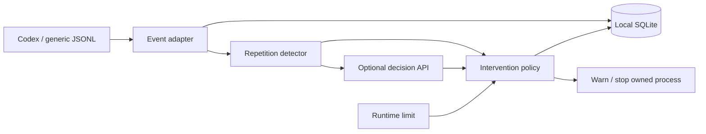
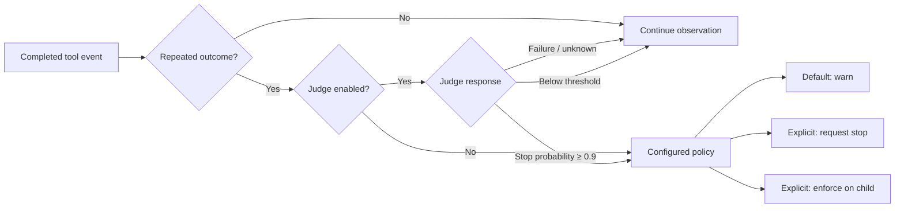
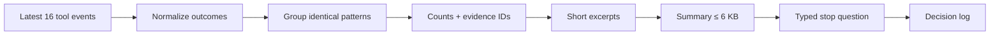
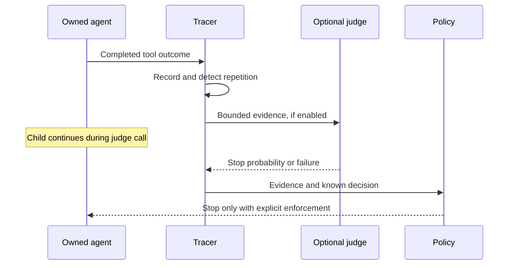
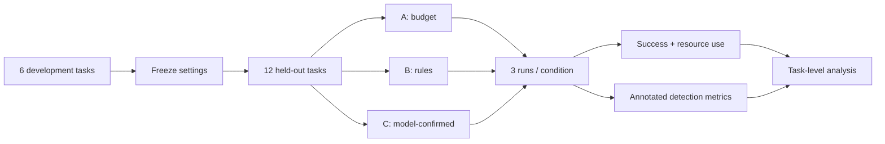

COURSE PRESENTATION

# LoopGuard

## Detecting Unproductive Agent Execution

Local-first monitoring · selective intervention · measurable tradeoffs

Notes:
This presentation describes an implemented monitoring method and a planned evaluation. Charts contain synthetic data; empirical effectiveness has not been established.

---

# Selective interruption under uncertainty

Can a lightweight monitor reduce wasted agent execution **without harming task success**?

- Coding agents can repeat failed actions or revisit unchanged results.
- Fixed budgets limit cost, but cannot distinguish useful retries from waste.
- Selective interruption may save work and may also stop productive attempts.

Notes:
Evaluate the tradeoff rather than assuming every repetition is a loop.

---

# System scope

- Python CLI + SQLite; dependencies and execution managed with uv.
- Single-agent Codex tasks; Codex JSONL and a generic event schema.
- Compare interruption policies under partial observability.
- Outside core scope: dashboards, fine-tuning, multi-agent coordination and a second full harness.

---

# Research objectives

1. Detect repeated tool outcomes under incomplete telemetry.
2. Quantify the resource–success tradeoff of selective interruption.
3. Assess transfer across agent environments with explicit adapter validation.

---

# Candidate agent environments

| Environment | Research role | LoopGuard status |
| --- | --- | --- |
| Codex | Primary evaluation harness | JSONL adapter implemented |
| DeepSeek Harness | Extensible runtime comparison | Candidate; adapter pending |
| Grok Build | Coding-agent comparison | Candidate; adapter pending |
| Cursor Agent CLI | Headless workflow comparison | Candidate; adapter pending |

Notes:
Core evaluation remains single-agent Codex. Candidates are an extension agenda, not implemented integrations or an expansion of the 108-run protocol. Official descriptions: https://www.deepseek.com/harness/en/ ; https://x.ai/build ; https://cursor.com/docs/cli/overview . Telemetry, permissions and cancellation semantics require validation before comparison.

---

# System architecture

Notes:
The tracer stores events and decisions locally. External inference is opt-in; only an explicitly launched child can be stopped. Unsupported metrics remain unknown.

---

# Operational definition of repetition

An identical **(tool, arguments, result, failed)** tuple occurs at least three times within the last sixteen completed tool events.

- Explicit progress clears the detection window.
- Matching uses normalized outcomes, not shortened display excerpts.
- Repetition is an observable proxy; it does not establish absence of progress.

Notes:
Legitimate polling and productive retries can satisfy the rule. The default threshold is configurable from 2 to 16.

---

# Observation comes first

- Default: record and warn; enforcement requires explicit configuration.
- Missing context / TPS measurements remain **unknown**.
- Silence alone is not evidence of wasted effort.
- Judge failure continues observation; the independent runtime limit remains active.

---

# Decision and fallback paths

Notes:
This diagram describes repetition-triggered intervention. The independent runtime limit is separate and remains active on judge failures. Missing metrics and silence never justify stopping.

---

# Evidence preparation pipeline

Notes:
The window begins after explicit progress. Full normalized outcomes determine identity; excerpts do not. External excerpts are unredacted. The byte budget is not a token count. Up to eight calls per run are spaced by four tool events.

---

# Synthetic interaction demo

<!-- widget: observation -->

Notes:
Click three times to illustrate a warning. This counter does not implement the detector's tuple matching or window semantics. Reset restores the initial state.

---

# Decision APIs: cost and context

<!-- widget: decision -->

Notes:
Specifications checked 2026-11-03 against provider sources linked on the slide. Cloudflare's official blog reports $0.038/M and 24k hosted context; its model-reference page could not be retrieved. Jev has distinct request/question limits; opt-in long context is not enabled by LoopGuard. Qwen is free during preview. These are published specifications, not live integration results. All adapters still require live validation.

--- | --- |
| TypeSafe Jev | Mock-tested adapter |
| Cloudflare Clef-Flash | Mock-tested adapter |
| Qwen decision-model-preview | Request adapted; live response validation pending |

Same question and trace window across models.

**No authenticated model evaluation has been run.**

---

# Evidence and data boundaries

- External judge requests contain grouped counts, evidence IDs and short **unredacted excerpts**, within 6 KB.
- Raw traces remain local; summaries can omit relevant context.
- Review trace contents before sharing; source code and secrets may be present.
- Up to eight judge calls per run, spaced by four tool events.

Notes:
A separate judge token budget is future work. This public demo contains synthetic content only.

---

# Live monitoring sequence

Notes:
The collector awaits the judge response while the child continues running. A response failure preserves observation. A timeout remains independent of the repetition policy.

---

# Evaluation protocol

| Condition | Intervention policy |
| --- | --- |
| A · Budget | Stop only at runtime limit |
| B · Rules | Budget + repetition-based interruption |
| C · Decision model | Budget + model-confirmed repetition interruption |

Replay evaluates detection. Fresh live runs measure realized savings.

---

# Evaluation pipeline

Notes:
Planned protocol, not completed experiments. Fix agent, prompts, permissions and budgets; reset repository snapshots and randomize condition order. Replay supports detector analysis, whereas fresh live runs measure realized savings.

---

# Sampling and experimental control

- Calibrate on **6 development tasks**, then freeze settings.
- Evaluate **12 held-out tasks × 3 runs × 3 conditions = 108 runs** for one judge model.
- A/B pilot: 72 runs. Each additional judge model: 36 runs.
- Include coding, loops, legitimate retries and slow successful operations.

Notes:
Fix agent, prompts, permissions and budgets; reset repository snapshots, use executable success checks and randomize condition order.

---

# Outcomes and annotation

| Measure | Purpose |
| --- | --- |
| Task success / false stops | Harm to productive work |
| Tokens / time / tool calls | Savings including judge overhead |
| Precision / recall / delay | Agreement with annotated segments |
| Cancellation failures | Whether interruption takes effect |

Two annotators label baseline segments and earliest defensible intervention.

Notes:
Report agreement and uncertain labels. Judge predictions are not ground truth. Report per-task results and task-level bootstrap intervals; runs are imperfect counterfactuals.

---

# Analysis framework

- Measure resource use jointly with task success and false interruptions.
- Report per-task estimates and task-level bootstrap intervals.
- Separate replay detection accuracy from savings in fresh live runs.
- Treat the following charts as **synthetic illustrations**, not findings.

Notes:
The protocol is planned. The small sample cannot establish statistical non-inferiority. Judge predictions are not ground truth.

---

# Token use across policies

<!-- widget: tokens -->

Notes:
Fabricated values: A 40k, B 26k, C 31k. These are layout fixtures, not findings or a forecast.

---

# Success and interruption tradeoffs

<!-- widget: quality -->

Notes:
Fabricated percentages; no sample size or confidence interval is claimed. Success and false-stop rates are separate illustrative metrics.

---

# When repeated effort ends

<!-- widget: timeline -->

Notes:
Synthetic trajectories flatten when the illustrative policy stops tool execution. They are not replay traces.

---

# Implementation and empirical status

- Implemented: event adapters, SQLite tracing, repetition rules and explicit interruption.
- Decision-model adapters have mock coverage; live inference remains unverified.
- Held-out evaluation has not been conducted.
- Resource savings and effects on task success remain **unknown**.

---

# Threats to validity

- False interruptions can damage otherwise successful work.
- Progress may be hidden and telemetry incomplete.
- Evidence summaries may omit important details.
- Conclusions apply only to the evaluated tasks and harness.

Notes:
The contribution is an empirical comparison under partial observability, not a universal guarantee of safe stopping.

---

# Conclusion

LoopGuard separates **observation**, **evidence assessment**, and **intervention** in agent execution.

- A local monitor makes repeated outcomes observable and replayable.
- Explicit policies govern interruption under incomplete telemetry.
- Whether selective stopping reduces cost without unacceptable harm remains an empirical question.

---

# References

- [Codex non-interactive mode](https://learn.chatgpt.com/docs/non-interactive-mode)
- [Project proposal](https://github.com/jay-waves/comp7607a/blob/main/PROPOSAL.md)
- [Provider configuration and CLI usage](https://github.com/jay-waves/comp7607a/blob/main/README.md)
- [Paul Tol colour schemes](https://sronpersonalpages.nl/~pault/)

SYNTHETIC CHARTS · NO EMPIRICAL FINDINGS

