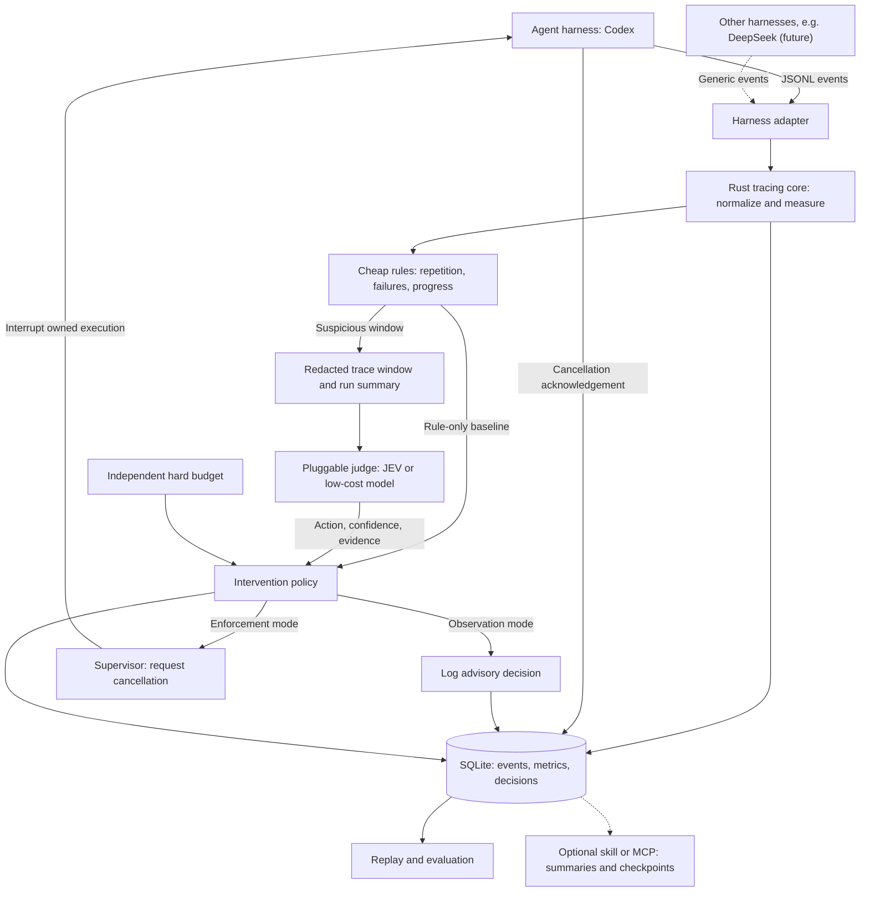

# LoopGuard: Detecting and Interrupting Unproductive Agent Execution

*Course Project Proposal*

## 1. Motivation and Research Question

Coding agents can repeatedly issue ineffective tool calls, revisit failed approaches, or consume additional context without measurable progress. Fixed time or token budgets limit cost but cannot distinguish productive exploration from wasted effort. Conversely, aggressive loop detection may terminate necessary retries or long-running work.

This project asks: Can a lightweight, harness-aware monitor reduce wasted agent execution while preserving task success? We investigate whether inexpensive trace-based triggers combined with selective model judgment outperform fixed budgets and repetition rules alone.

## 2. Scope and Contributions

The project targets single-agent coding tasks, with Codex as the primary integration. The deliverable is a small Rust tracing CLI backed by SQLite, a conservative intervention policy, and a reproducible evaluation. A harness-neutral event schema provides a path to other runtimes, including a harness using DeepSeek; implementing a second full integration is a stretch goal.

The intended contribution is an empirical comparison of interruption policies under partial observability, rather than a general observability platform or a newly trained foundation model. A dashboard, distributed tracing infrastructure, multi-agent coordination, and model fine-tuning are outside the core scope.

## 3. System Design

The diagram shows the target architecture. The prototype covers ingestion, local storage, rule-based detection, and opt-in supervised cancellation; typed Jev/Clef-Flash adapters are implemented, with live provider evaluation pending.

**Collection.** An external adapter consumes Codex's structured JSONL execution stream and maps supported events into a common schema. Records contain run and event identifiers, timestamps, tool names, arguments, results, errors, reported token usage, and explicit progress evidence when available. SQLite stores traces and decisions for inspection and deterministic replay. Storage is local; payload retention and redaction must be configurable before external judge calls.

**Measurement.** The monitor tracks repeated tool/argument/result patterns, recurring failures, tool latency, token expenditure, and observable progress such as changed test outcomes. Context occupancy is recorded only when explicitly available; input-token counts are not treated as current context length. Generation TPS requires output-token counts and a matching generation interval. When these are unavailable, TPS remains unknown. Event silence is tracked separately: it may indicate generation, a slow tool, or a stalled connection, and alone does not establish wasted effort.

**Detection.** Cheap rules identify suspicious windows, including repeated unchanged outcomes and short recurring action cycles. A bounded recent-event window and compact run summary are then passed to a pluggable judge. TypeSafe Jev and Cloudflare Clef-Flash are candidate typed decision models; both accept state and questions and return typed probabilities. The judge returns a structured action (continue, request redirection, or request stop), confidence, reason, and supporting event identifiers. Judge latency, token use, and invocation count are included in the total cost.

**Control.** Observation-only mode is the default. An enforcing supervisor may interrupt the execution it owns after a configured decision threshold. A stop request is distinct from successful cancellation and must be acknowledged and recorded. Judge failures or invalid responses fall back to observation, while a separate hard budget remains enforceable. A skill or MCP interface may expose trace summaries and cooperative checkpoints; it is not assumed to observe every tool call or independently control the host. The minimum intervention is stopping a supervised run; automatic redirection is optional.

## 4. Experimental Design

**Dataset.** Construct 24 small, automatically graded repository tasks spanning bug repair, implementation, and debugging. Include productive retries and slow-but-valid operations as negative controls, alongside seeded repeated failures, circular searches, and missing prerequisites. Keep task families disjoint between development and held-out evaluation: eight development tasks and sixteen test tasks, with three runs per condition. Record versions, prompts, budgets, and sampling settings.

**Conditions.** Compare (A) the agent with only a fixed hard budget, (B) rule-based intervention, and (C) rules with selective model judgment. Keep the agent model, tool access, and hard budget fixed. Compare a compact trace summary against a longer trace window as an ablation; compare JEV against a cheaper judge if access and resources permit.

**Ground truth.** Use executable task tests for success. Independently annotate suspicious trace segments for progress and the earliest defensible intervention point, reporting agreement and resolving disagreements. Do not use the judge's own labels as ground truth. Define annotation criteria and select thresholds using development data only.

**Metrics.** Report task success, total tokens, wall time, tool calls, judge overhead, detection precision/recall, and intervention delay. Measure harmful interruptions through paired unmonitored runs where feasible, acknowledging stochastic counterfactual uncertainty. Report per-task outcomes and task-level bootstrap confidence intervals. Offline replay assesses detection behavior; live supervised trials are required to measure actual savings and cancellation reliability.

**Success criterion.** Aim for at least 20% lower median token expenditure on annotated unproductive runs, with no more than a five-percentage-point reduction in overall task success. These are exploratory targets; the small sample may not establish statistical non-inferiority. Report failures and uncertainty rather than treating the targets as guaranteed results.

## 5. Implementation Plan and Deliverables

- Week 1: Rust CLI, SQLite schema, generic JSONL ingestion, Codex adapter, and trace fixtures.
- Week 2: Repetition rules, replay tests, supervised cancellation, and decision logging.
- Week 3: Judge interface, compact versus longer-context inputs, and development-set calibration.
- Week 4: Held-out experiments, ablations, failure analysis, and final report.

Deliverables include source code, documented event and judge contracts, reproducible fixtures and evaluation scripts, and GitHub Actions for tests, release builds, and version-tagged binary distribution. The prototype implements collection, advisory detection, and opt-in supervised cancellation; authenticated model evaluation remains a subsequent milestone.

## 6. Risks and Limitations

Repeated actions can be legitimate, progress can be hidden, and a judge can be confidently wrong. Conservative defaults, explicit missing-data handling, negative controls, and logged evidence mitigate these risks. Codex event availability limits measurement fidelity, while a common schema alone does not prove cross-harness generalization. Findings will therefore be scoped to the evaluated tasks, runtime versions, and observable signals.

## Reference

OpenAI, "Non-interactive mode," [official documentation](https://learn.chatgpt.com/docs/non-interactive-mode) (accessed November 3, 2026). Documents the Codex JSONL execution interface used by the primary adapter.
